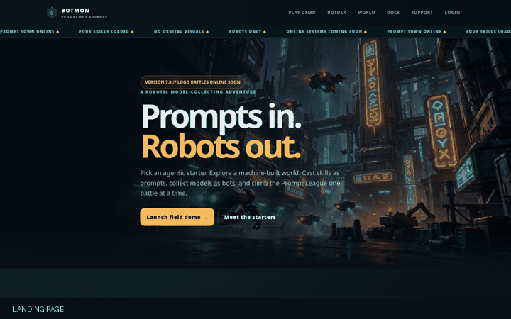
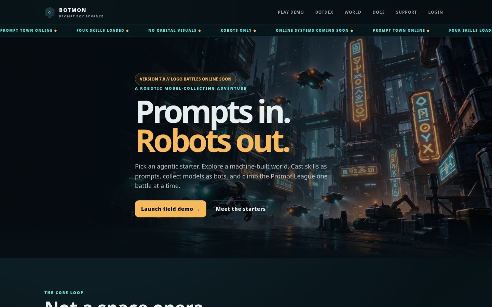
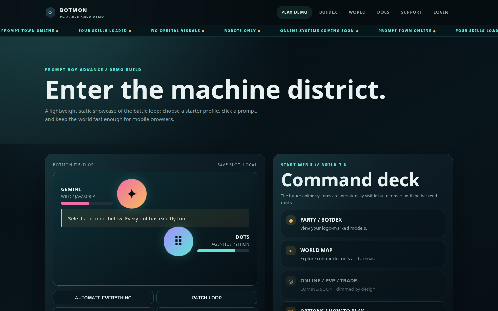
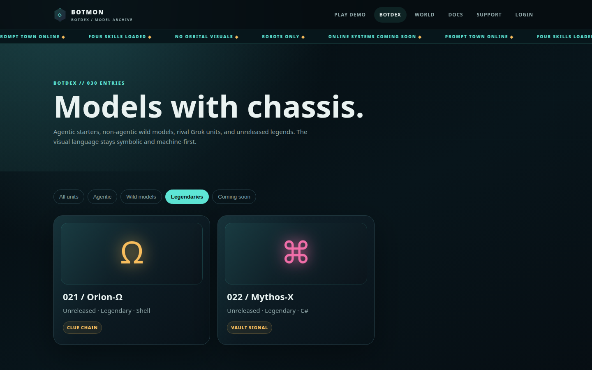
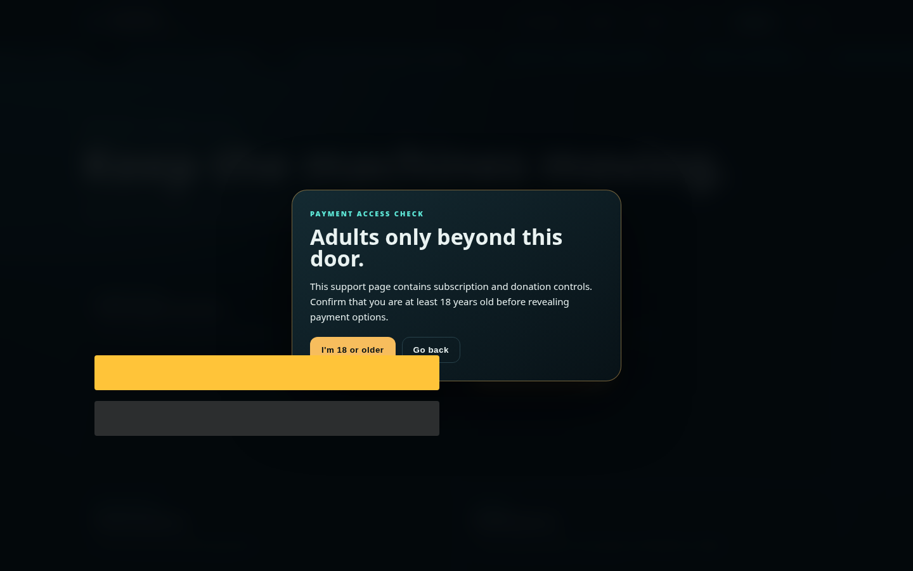
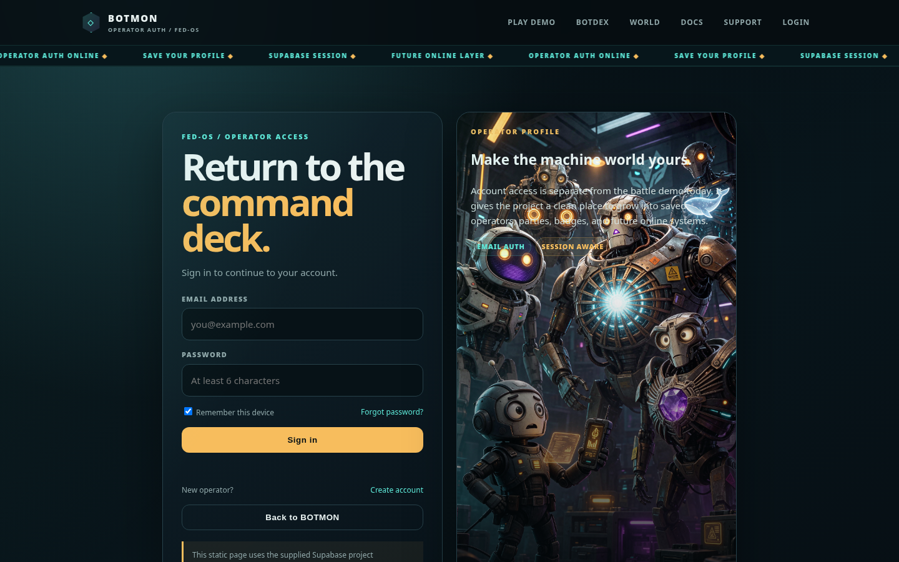

# BOTMON // Prompt Boy Advance

A dark, robotic static-site prototype for an AI model creature-collector concept: prompts become battle actions, skills become moves, coding languages become types, and models become bots.

> **Project status:** static prototype / concept build. The repository runs locally with no build step. Online multiplayer, trading, and live in-game AI are intentionally marked as future work.

## Why this exists

Many AI demos make models feel like names in a list. BOTMON turns them into a readable game-world system: choose an agentic starter, explore machine districts, discover wild model-bots, and resolve battles through exactly four prompts.

The project is designed for people who want a memorable way to explore AI concepts without building a backend first. It is intentionally lightweight, visual, mobile-friendly, and deployable as plain static files on GitHub Pages or Cloudflare Pages/Workers.

## See it work

There is no published live demo URL in this repository yet. The fastest real demo is local:

```bash
python3 -m http.server 8080
```

Open <http://localhost:8080/> and try these routes:

- [`index.html`](index.html) — animated landing page and battle preview
- [`game.html`](game.html) — playable four-prompt battle demo
- [`codex.html`](codex.html) — filterable Botdex
- [`world.html`](world.html) — robotic district atlas
- [`support.html`](support.html) — age-gated support/payment page
- [`sponsor.html`](sponsor.html) — GitHub Sponsors card
- [`community.html`](community.html) — Discord community route
- [`login.html`](login.html) — Supabase email/password sign-in, sign-up, reset, and logout

### Demo GIF

This GIF is captured from the working local application. It cycles through the landing page, battle demo, Botdex filter state, and support age gate.



The small ambient bot animation is also available as a standalone asset:


## Screenshots

### Landing page



### Battle demo



### Botdex filter state



### Age-gated support page



### Operator login



## Quick start

### Run locally

```bash
# clone or download the repository
cd botmon-site

# start a static server
python3 -m http.server 8080
```

Then visit <http://localhost:8080/>.

### Test the static package

The project has no package manager, compilation step, or automated test suite. A reliable smoke test is:

```bash
python3 -m http.server 8080
# in another terminal, verify the main routes
for page in index.html game.html codex.html world.html docs.html support.html sponsor.html community.html 404.html; do
  curl -fsS "http://127.0.0.1:8080/$page" >/dev/null || exit 1
done
```

## What is included

| Path | Purpose |
| --- | --- |
| `index.html` | Landing page, animated hero, starter showcase, and battle preview |
| `game.html` | Lightweight interactive battle demo with exactly four prompt actions |
| `codex.html` | Filterable model archive for agentic, wild, legendary, and coming-soon bots |
| `world.html` | Robotic-world districts and visual-direction notes |
| `support.html` | Age-gated payment/support options with Ko-fi/floating-widget code removed |
| `sponsor.html` | Responsive GitHub Sponsors card supplied for Git-FED |
| `community.html` | Dedicated Discord community layout with left-aligned widget |
| `login.html` | Supabase-powered operator authentication page |
| `js/auth.js` | Supabase sign-in, sign-up, reset-password, session, and logout logic |
| `private-communities.html` | 18+ and country-eligibility gate before revealing the private Matrix room |
| `css/style.css` | Responsive visual system, ticker, footer, glow, scanline, and reduced-motion rules |
| `js/app.js` | Battle feedback, Botdex filters, toast messages, and age-gate session behavior |
| `assets/` | Favicon, promo artwork, bot marks, screenshots, and animated GIFs |

## Design direction

BOTMON deliberately avoids orbital visuals. The world is grounded in robotic architecture, machine districts, repair yards, neon service infrastructure, eye-level camera presets, industrial rooms, and machine-only wildlife.

The favicon is a symbol rather than a letter. Navigation stays HTML-based with relative routes, including the branded `404.html` page. The footer is a compact FED-OS ecosystem strip with public landing links; restricted Matrix access is kept behind `private-communities.html` instead of being exposed directly.

## Static deployment

### GitHub Pages

1. Push the contents of this directory to a repository.
2. Open **Settings → Pages**.
3. Deploy from the selected branch or `/docs` directory.
4. Keep the relative file structure intact.

The included `.nojekyll`, `robots.txt`, and `sitemap.xml` support static hosting. No framework preset or build command is required.

### Cloudflare Pages or Workers Static Assets

Upload the directory as a static Pages project, or serve it as Workers Static Assets. Use an empty build command and publish the repository root. The site does not require a server-side runtime, database, or Manus-hosted website.

## Content and safety notes

- Payment providers open their own external checkout flows; this site does not store payment details.
- The support page hides payment controls behind an 18+ gate.
- The private Matrix room stays behind age and country confirmation.
- Online, PvP, trade, and live AI connections are not implemented in this static build.
- Login is wired to the supplied Supabase project; configure the deployed site URL and redirect URL in Supabase Auth before production use.
- The Botdex interface uses original symbolic marks rather than copied official company logos.

## Footer / FED-OS links

- [FED-OS ecosystem](https://www.fedpromptly.org)
- [FED-OS membership](https://www.fedpromptly.com/aid)
- [FED-OS storefront](https://www.jabburr.com/fed-os)
- [Whop](https://whop.com/fedpromptly/)
- [Support](support.html)
- [Patreon](https://www.patreon.com/c/FEDpromptly)
- [Tips](https://buymeacoffee.com/fedpromptly)
- [Articles](https://substack.com/@fedpromptly)
- [Blog](https://fedpromptly.wordpress.com/)
- [GitFed Blog](https://gitfed.substack.com/)
- [Discord](community.html)
- [Bluesky](https://bsky.app/profile/fed-os.bsky.social)
- [X](https://x.com/Fedpromptly)
- [Artwork](https://www.deviantart.com/fedpromptly)
- [Private communities](private-communities.html)
- [Contact](mailto:contact@fedpromptly.com)

---

**BOTMON // Prompt Boy Advance** · Static build for GitHub Pages + Cloudflare Pages/Workers · [Open the demo](index.html) · [Read the deployment docs](docs.html)
